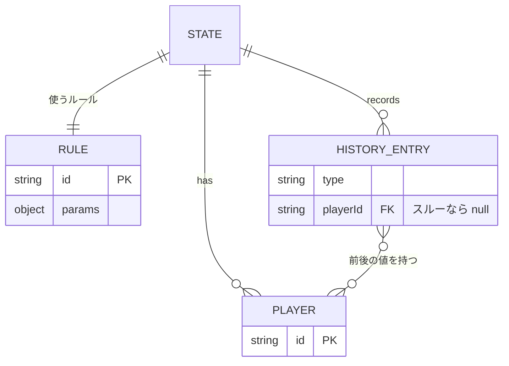

# 草案: クイズのルールを切り替えられるようにする

## 結論

- 今の「+1/-1」「○/✕」の切り替えを「ルール」の切り替えに広げる。11ルールを足し、今の2つと合わせて13ルールにする。
- 各ルールは「○・✕・スルー・換算が押されたら全員の状態をどう変えるか」を返す純粋な関数として `src/rules/` に1ファイルずつ置く。reducer は共通の1アクションでそれを呼ぶだけにする。
- 「今何問目か」を `state.questionNo` で数える。○かスルーで1つ進む。休みは「何問目まで休むか」をプレイヤーに持たせて判定する。
- 元に戻す（undo）は「変わった値の前後」を記録する方式にする。阻止・全員減点・問題の数の進みも、同じ仕組みで戻せる。

## ユーザーと決めた前提（2026-10-20）

| 論点 | 決定 |
|---|---|
| 入れるルール | 最初の4つ（アップダウン・m○n×・10by10・マンオブ風通過）＋追加調査の8つ。マンオブ風は通過クイズの設定の1つにまとめる |
| ルールの数字 | 大会ごとに変えられる（入力欄で設定） |
| 勝ち抜け・失格 | ボードが自動で判定する。該当者のボタンを止めて表示を出す。優勝演出は今と同じく手動 |
| タイマー | 今回は入れない |
| 問題の数 | 数える仕組みを作る（休み・問題番号で点が変わるルールのため） |

根拠は atwiki の「ルール」一覧の20ページ。4ページは直接読み、15ページは Web の保存版（Wayback Machine）で読んだ。うち6ページ（アタック風サバイバル・ザー・青天井・上座・空席待ち・10hits Combo）は2016年の版で、今のページと違う可能性がある。

## ルールの仕様

「問題が進む」は `questionNo` が1つ増えること。どのルールでも、○（正解）かスルーで進み、✕（誤答）では進まない。誤答のあとほかの人が答えられる早押しの流れに合わせるためである。

### 問題の数を使わないルール（9つ）

| ルール | ○（正解） | ✕（誤答） | 勝ち抜け | 失格 | 設定できる数字（既定値） |
|---|---|---|---|---|---|
| 自由得点（今の +1/-1） | +1 | −1 | なし | なし | なし |
| 自由○×（今の ○/✕） | ○+1 | ✕+1 | なし | なし | なし |
| プラス1マイナス1 | +正解の点 | −誤答の点 | 勝ち抜け点に達する | なし | 正解の点 1・誤答の点 1・勝ち抜け点 10（0なら無し） |
| アップダウン | +1 | 誤答のたびに0点に戻る。誤答数が上限に達したら失格 | 勝ち抜け点に達する | 誤答数が上限 | 勝ち抜け点 7・失格の誤答数 2 |
| m○n× | ○+1 | ✕+1 | ○がm個 | ✕がn個 | m=7・n=3 |
| 10by10 | 正解数+1 | 残り誤答数−1 | 正解数×残り誤答数が目標以上 | 残り誤答数が0 | 開始時の残り誤答数 10・目標 100 |
| 通過クイズ | 一般席で+1。上がる点で通過席へ。通過席で正解なら勝ち抜け | 下の「通過クイズの設定」による | 通過席で正解 | 誤答数が上限（0なら無し） | 下の表 |
| アタック風サバイバル | 自分以外で勝負が決まっていない全員が−1 | 自分が−1 | 残り1人になったらその人 | 0点 | 持ち点 20 |
| ザー | 今の段階の○+1。段階の数だけ○が揃えば次の段階へ。最後の段階を越えたら勝ち抜け | ✕+1 | 最後の段階を越える | 誤答数が上限 | 段階の数 3・失格の誤答数 3 |

ザーの段階: ○1つで1段目、○2つで2段目、○3つで3段目を越える。誰かが段階を越えると、ほかの人の「今の段階の○」は0に戻る。越えた本人も、次の段階は○0から始める。越えた段階は失わない。

#### 通過クイズの設定

選ぶと「一般形」「マンオブ風」のひな形を選べる。ひな形のあとで設定を変えてもよい。

| 設定 | 一般形 | マンオブ風 |
|---|---|---|
| 通過席に上がる点 | 3 | 2 |
| 阻止できる人（その人が正解すると通過席の人が0点で一般席に戻る） | 通過席の人以外の全員 | 上がる点の1つ手前の人だけ（既定では1点の人） |
| 一般席での誤答 | −1点 | ✕+1 |
| 通過席での誤答 | −1点（一般席に戻る） | 0点で一般席に戻る（✕には数えない） |
| 失格の誤答数 | 0（無し） | 3 |

阻止した人自身も○の分は+1される。マンオブ風では阻止した1点の人が2点になり、そのまま通過席に上がる。どちらのひな形でも、通過席に上がる正解は必ず阻止になる。そのため通過席にいるのは常に1人までになる。「阻止権は1点の人だけ」「通過席での✕は失格の回数に数えない」は atwiki の原文どおり。

### 問題の数を使うルール（4つ）

| ルール | ○（正解） | ✕（誤答） | 勝ち抜け | 失格 | 設定できる数字（既定値） |
|---|---|---|---|---|---|
| m○n休 | ○+1 | ✕+1。休みに入る | ○がm個 | 誤答数が上限（0なら無し） | m=7・休む問題数 3・休み方「毎回同じ」か「1回目は1問・2回目は2問と増やす」・失格の誤答数 0 |
| 青天井 | +今の問題番号（1問目は1点、2問目は2点） | −今の問題番号（減点しない設定もできる） | 勝ち抜け点に達する（0なら無し） | なし | 誤答で減点する・勝ち抜け点 0・問題数の上限 0（無し） |
| 10hits Combo（V版） | 連答が続けば連答数+1、続かなければ連答数1。連答2で+1・3で+2・4で+3 | 連答数0。1回目の誤答は1問休み・2回目は2問休みと増える | 連答数が5になる。または10点に達する | なし | 勝ち抜け点 10・勝ち抜けの連答数 5 |
| ポイント換算クイズ | ためた○+1 | ためた○があれば0にする。無ければ3問休み | なし（点数の順） | なし | 休む問題数 3・問題数の上限 35 |

- 10hits の連答は1人しか持てない。ほかの人が正解すると、その人の連答数は0に戻る。ほかの人の誤答やスルーでは0に戻らない（原文どおり）。
- ポイント換算はカードの「換算」ボタンで、ためた○を点に換える。点は○の数の2乗（1・4・9…）。換えたら○は0になる。換算では問題は進まない。休み中も換算できる（答えるわけではないため）。ためた○が0のときは押せない。
- 問題数の上限に達したら、全員のボタンを止めて「〇問終了」と出す。換算もできなくなり、換えていない○は点に入らない。

### 共通の決まり

- 勝ち抜けた人には「1抜け」「2抜け」のように順番を付ける（前提の質問には入れていない。草案で足した）。
- 休み中・勝ち抜け・失格の人は、本人のボタンを止める。reducer でもその人の○✕を受け付けない。
- スルーボタンは問題の数を使う4ルールのときだけ画面に出す。ほかのルールでも ○ で数は進むが、表示はしない。

## 問題の数を数える仕組み

```text
第5問で A が誤答（休む問題数 3）→ A.restUntil = 5 + 3 = 8
  第5問: A は答え済み（この問題はもう答えられない）  表示「休み あと3問」
  第6問〜第8問: A は休み                              表示「あと2問」→「あと1問」→「この問題まで」
  第9問: A は答えられる
```

- `state.questionNo` は「終わった問題の数」。今の問題番号は `questionNo + 1`。○かスルーで1増える。
- プレイヤーの `restUntil` は「何問目まで休むか」。今の問題番号が `restUntil` 以下なら休み中とする。誤答した問題そのものも同じ式で「答えられない」になるので、別の判定は要らない。
- 休みの表示は「あと（restUntil − 今の問題番号）問」。0のときは「この問題まで」と出す。
- スルーは `answer/record` の `result: 'through'`・`playerId: null` として記録する。押し間違えは undo で戻す。問題番号を直接打ち込む欄は作らない。
- CSV の問題表示（`currentIndex`）とは連動させない。今の「次の問題」「前の問題」は読み返しのために自由に戻れる操作で、undo の対象でもないからである（要確認に入れた）。

## データの持ち方



- `state.rule = { id, params }` と `state.questionNo` を足す。`state.mode` は `rule.id` に置き換える。保存済みの `mode: 'score'` は自由得点、`'circle-cross'` は自由○×として読み込む。
- プレイヤーには、勝ち負けに関わる値を次の9個持たせる。どのルールでも全部持つ（今の「両モードのフィールドを常に持つ」方針をそのまま広げる）。
  - 今からある: `score / correct / wrong`
  - 勝ち負け: `finish`（未決 / 勝ち抜け / 失格）・`finishOrder`（何番目か）
  - ルール専用: `restUntil`・`stock`（ポイント換算でためた○）・`stage`（ザーで越えた段階の数）・`streak`（10hits の連答数）
  - 通過席にいるかは「点数が上がる点以上か」で出せるので、フィールドにしない。
  - この9個の名前の一覧を `PLAY_FIELDS` として1か所に置く。履歴の前後の値・リセット・sanitize はこの一覧を使う。足し忘れを防ぐためである。
- ザーの「今の段階の○」は `score` で持つ。10by10 の残り誤答数は「開始値 − wrong」で出し、フィールドにしない。
- `finishOrder` は勝ち抜け・失格が決まった瞬間に「それまでに同じ finish になった人数 + 1」を計算してプレイヤーに保存する。失格にも番号を付け、サバイバルの順位（後に落ちた人が上）に使う。同時に2人以上が0点になったときは同じ番号を付ける。
- 持ち点が0でないルール（アタック風サバイバルの20点）は、ルールごとの「最初の値」を持つ。ルールを切り替えたときと、途中でプレイヤーを足したときに使う。
- 履歴の新しい型 `answer/record` は次の形にする。undo は before を、redo は after を書き戻すだけ。

  ```js
  {
    type: 'answer/record',
    playerId,                     // 押した人。スルーなら null
    result,                       // 'correct' | 'wrong' | 'through' | 'convert'
    changes: [{ id, before, after }], // PLAY_FIELDS のうち変わった人だけ
    questionNo: { before, after },
  }
  ```

  - ルールの関数は「変えたあとの全員」と `questionNo` を返すだけにする。changes は reducer が前後を比べて作る。ルールごとに記録の書き方を間違えないためである。
  - before / after に入れるのは `PLAY_FIELDS` だけ。プレイヤー全体を写すと、間に挟まった改名やロックまで undo で巻き戻ってしまう。
  - 前後の値は差分ではなく実際の値なので、途中の entry が消えても残りの undo は壊れない。
- `player/remove` は次のように直す。
  - entry は1つも消さない。changes から消した人の分だけ取り除く。`historyIndex` は触らない。
  - 今のように消した人の entry を消すと、その entry がほかの人に与えた変化（サバイバルの全員−1・阻止・問題の数の進み）が履歴から消える。するとほかの人の undo が途中で食い違う。
  - undo / redo は、今いないプレイヤーの id を無視する。
- 今の `score/update`・`circle/record` の履歴は、読み込み時に `answer/record` へ変換する。reducer の undo / redo は1本にする。`mode` → `rule` の読み替えも同じ読み込み処理で行う。
- `persistence.js` の sanitize に `rule`・`questionNo`・`PLAY_FIELDS`・`answer/record` を足す（CLAUDE.md の落とし穴どおり）。`rule.id` は決まった13個だけ通す。`params` はルールごとの既定値で埋める。数字は0以上の整数か、選択肢は決まった値か確かめる。`PLAY_FIELDS` も項目ごとに確かめる（`finish` は3つの値のどれか、ほかは0以上の整数）。

## ルールを切り替えたときの扱い

- ルールや数字を変えると点数の意味が変わる。そのため確認を出してから、点数・履歴・問題の数を戻す。プレイヤーは残す。
- 履歴が空で問題も0問なら、確認なしで切り替える（サバイバルは最初から20点を持つので、点数では判定しない）。
- 戻す対象は `PLAY_FIELDS` と `questionNo`。戻す先はルールの「最初の値」。今の「スコアリセット」（`scores/reset`）も同じ対象を戻す。ロックを外す今の動きは残す。

## ロックとの関係

- ロックは今どおり本人のボタンを止めるだけにする。ルールの関数はロックを見ない。ロック中の人も、阻止やサバイバルの減点は受ける。
- 休み・勝ち抜け・失格はボードが自動で決める。ロックとは別の札で表示する。

## 画面の変更

- 準備バーの「+1/-1｜○/✕」の切り替えを「ルール」ボタンに置き換える。押すとルールの選択と数字の入力欄が出る。通過クイズではひな形（一般形・マンオブ風）も選べる。
- 問題の数を使う4ルールでは、画面の上に「第5問」と「スルー」ボタンを出す。上限があるルールは「第5問 / 35」と出す。
- カードの表示はルールごとに変える。
  - アップダウン: 点数と残りの誤答の回数
  - m○n×: 「○ 3/7」「✕ 1/3」
  - 10by10: 「4 × 8 = 32」
  - 通過クイズ: 点数・「通過席」の札・阻止できる人に「阻止権」の札
  - ザー: 「2段目 ○1/2」
  - アタック風サバイバル: 残りの持ち点
  - m○n休・10hits・ポイント換算: 「休み あと2問」の札。10hits は「連答 3」、ポイント換算は「○3（換えると9点）」と「換算」ボタン
- 勝ち抜けた人は「1抜け」の札、失格の人は「失格」の札を付けてボタンを止める。今のロック（手動）はそのまま残す。
- ボタンの文字はルールごとに持つ。自由得点は今どおり +1 / −1、ほかは ○ / ✕。
- 「得点順」の並び替えは、勝ち抜けた順 → ルールごとの成績 → 失格の順（後に落ちた人が上）にする。比べ方は `src/rules/` 側に置き、ScoreBoard はそれを呼ぶだけにする。
- 優勝演出（WinnerOverlay）とヘルプ（HelpModal）は今 `mode` で表示を分けている。ルールごとの表示に直し、ヘルプに13ルールの説明を足す。

## 案の比較

| 案 | 却下理由 |
|---|---|
| ルールごとに reducer のアクションを分ける（`updown/answer` など） | undo・redo・sanitize の4箇所がルールの数だけ増え、足すたびに漏れやすい |
| 履歴を最初から再生して今の点数を出す | 履歴は保存時に直近500件へ切り詰めるため、古い分を再生できない |
| **採用: ルールを純粋関数にし、履歴は前後の値で持つ** | — |
| 問題の数に CSV の `currentIndex` を使う | CSV を読み込まないと使えない。読み返しで前に戻すと休みまで巻き戻る。undo の対象でもない |
| 休みを「残りの問題数」で持ち、問題が進むたびに全員から1引く | 問題が進むたびに休み中の全員が変わり、履歴が人数ぶん膨らむ。誤答した問題そのものを数えるかで1ずれやすい |
| **採用: `questionNo` と「何問目まで休むか」（`restUntil`）** | — |
| 10hits の連答を `state.combo = { playerId, count }` で持つ | state 側に持つと履歴の前後の値に別の欄が要る。プレイヤーの `streak` にすれば今の仕組みにそのまま乗る |

## 見送ったルール

| ルール | 見送る理由 |
|---|---|
| 5ジャンル制覇 | 正解のたびにジャンルを選ぶ画面が要る |
| 上座 | 席の上下を入れ替えるルールで、番組ごとに形が大きく違う |
| 空席待ち | 席が空くのを待つ列の管理で、点の付け方ではない |
| サイドアウト | 解答権を相手に移す進め方の決まりで、点は変わらない |
| タイムレース | タイマーが要る（今回は入れないと決定済み） |
| サバイバル | 「下位から脱落する形式」の総称で、決まった点の付け方が無い |
| 進級クイズ | 原文を読めていない |

## やらないこと

- タイマー（10by10・10hits の15分制限など）
- アップダウンの「お戻り」（失格者の復帰）と、0点のときの誤答だけ失格にする変種
- 通過クイズの「一般席の誤答で1回休み」の変種
- 全員が休みのときの自動スキップ（スルーを押して進める）
- 10hits の初版・R版（V版だけ入れる）
- 見送ったルール
- 団体戦（10by10by10）・ペーパーテストの初期点

## 実装の順番と確かめ方

2回に分けて公開する。前半だけでも使えるようにするためである。前半・後半とも 2026-10-20 に実装して公開した。

前半（問題の数を使わない9ルール）

1. `src/rules/` に9ルールの関数と `PLAY_FIELDS` を置く。`PLAY_FIELDS` には後半で使う `restUntil`・`stock`・`streak` も最初から入れる → `node --test`（Node 24 の標準機能）で確かめる。見るのは勝ち抜け・失格・阻止・全員減点・段階の越え方
2. reducer に `rule/set` と `answer/record`（`questionNo` の前後も含む）、undo・redo、`player/remove` の直しを足す。○で `questionNo` を進める処理もここで作る → undo・redo とプレイヤー削除も同じテストに入れる
3. 保存と読み込み（sanitize・`questionNo`・古い `mode` と履歴の読み替え）→ 古い形のデータを入れて再読み込みし、点数と undo が残るか見る
4. ルール設定の画面・カードの表示・並び替え・ヘルプ → `npm run dev` で9ルールを1回ずつ操作する。`npm run lint` と `npm run build` を通して公開する

後半（問題の数と4ルール）

5. スルー・換算・休みの判定と4ルールの関数 → `node --test` で休みの始まりと終わり・連答・換算・上限を確かめる
6. 「第n問」とスルーボタン・休みと連答と換算の表示 → `npm run dev` で4ルールを1回ずつ操作する。lint と build を通して公開し、README を直す

触るファイルは前半で10前後、後半で5前後の見込み。実装に入るときは deep-code の手順で進める。

## 要確認（実装前に決めたいこと）

- CSV の「次の問題」を押したら問題の数も進めるか。草案では連動させない。CSV の問題を読みながら進める人は、誰も答えなかった問題でスルーを押し忘れやすい。連動させる場合は「前の問題」で数をどう戻すかも決める。
- ザーで自分が誤答したとき、今の段階の○が消えるか。原文に書かれていないので、消えないと仮定した。
- アタック風サバイバルで残り1人になったら自動で勝ち抜けにするか。草案ではする。
- 10by10 の初期の残り誤答数を6にする大会（abc 21st）もある。設定で変えられるので既定値は10のままにした。
- 「1抜け」「2抜け」の表示を入れるか。草案では入れている。

## プランレビュー

1回目（6ルールの時点）と2回目（13ルールと問題の数を足した時点）の2回通した。

- レビュアー: fable-advisor（作成者 Opus とは別モデル）。2回目は reducer.js・persistence.js・initialState.js と照らして読んだ
- 1回目の主な指摘と反映
  - 履歴の前後の値に入れる項目・古い履歴型と `mode` の扱い・リセットの対象が未定 → 決めて書いた
  - ロックと自動判定の関係・画面の抜け（WinnerOverlay・HelpModal・並び替え・ボタン文字）→ 節と項目を足した
  - 「1抜け」表示が前提にない → 草案で足したと明記し、要確認に入れた
- 2回目の主な指摘と反映
  - `player/remove` で消した人の entry を消すと、ほかの人の undo が食い違う → entry は消さず、changes から除くだけにした
  - `finishOrder` を計算で出すと「後に落ちた人が上」を出せない → 決まった瞬間に保存すると直した
  - 前半と後半の分け方では `questionNo` を後半で作り直すことになる → 前半の履歴と保存に含めた
  - サバイバルの減点で負の点が出る・換算と休みや上限の関係が未定 → 決めて書いた
  - 「阻止できるのは1点の人」は上がる点を変えると成り立たない → 「上がる点の1つ手前の人」にした
  - 通過席は仕様上いつも1人まで → 要確認から外し、`seat` も点数から出すことにした
  - アップダウンの誤答・ザーの段階の書き方・切り替え確認の条件・sanitize の検査の書き方 → 直した
- 見送った指摘
  - 通過クイズの阻止権の解釈が一般的な形と違う可能性（1回目）→ 読めた atwiki 原文どおりにした。一般形のひな形で「全員が阻止できる」形も選べるようにした
